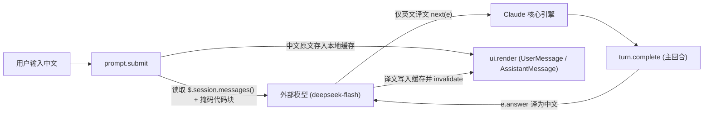

# bilingual-translator

Claude Code 进程内双语翻译 Mod：在 CLI 终端实现**中文输入自动译英发送** + **最终英文回复自动译中展示**，使用独立的外部 OpenAI 兼容模型（默认 `deepseek-flash` 并关闭思考），**不占用 Claude 配额，且中文原文绝不进入 Claude 请求上下文**。

---

## 核心特性

- **输入中译英（`prompt.submit`）**：检测到输入含中文时自动译成英文发送；跳过 `/slash` 命令与纯英文输入。
- **零上下文泄漏**：中文原文只存本地内存与 `$.store`，`next({ ...e, text: translated })` 只传递英文译文，不修改 `e.context`。
- **界面双语对照（`ui.render`）**：
  - 用户消息（`UserMessage`）：显示 `[原文] <中文>` 与 `[已发送] <英文>`。
  - 助手最终回复（`AssistantMessage`）：在 `turn.complete`（跳过子代理与中断回合）后自动译为中文，刷新显示 `英文原文 + [中文译文]`。
- **全量历史消歧**：调用 `$.session.messages()` 读取当前会话的完整 `user` / `assistant` 对话文本作为翻译参考，解决代词指代与术语一致性问题；若超出外部模型上下文限制，自动降级为无历史重试。
- **代码块保护**：翻译前抽离 ```` ```...``` ```` 与 `` `...` `` 为占位符，翻译完成后原样还原，避免破坏代码、命令与路径。
- **安全降级**：外部翻译接口超时、报错或未配置密钥时，自动放行原文并通过 `toast` / `log` 提示，不阻塞正常使用。

---

## 工作流程



---

## 安装与配置

### 1. 通过 Marketplace 安装

```text
/plugin install bilingual-translator --marketplace Everless321/claude-translator-mod
```

或在终端运行：

```bash
claude plugin marketplace add Everless321/claude-translator-mod
claude plugin install bilingual-translator@everless-mods
```

### 2. 配置密钥与模型（任选一种）

- **方式 A：标准插件配置（推荐，密钥存入系统安全凭据库）**
  ```bash
  claude plugin configure bilingual-translator@everless-mods
  ```
- **方式 B：会话内命令行即时设置**
  ```text
  /tr set key 你的API_KEY
  /tr set url https://api.deepseek.com/v1
  /tr set model deepseek-flash
  ```
- **方式 C：本地覆盖文件**
  创建 `~/.claude/bilingual-translator.local.json`（权限建议 `600`）：
  ```json
  {
    "apiBaseUrl": "https://api.deepseek.com/v1",
    "apiKey": "sk-...",
    "model": "deepseek-flash",
    "disableThinking": true
  }
  ```

### 配置项说明（`plugin.json` `userConfig`）

| 配置项 | 默认值 | 说明 |
| :--- | :--- | :--- |
| `apiBaseUrl` | `https://api.deepseek.com/v1` | OpenAI 兼容接口地址（支持 DeepSeek、DashScope、OpenRouter、本地 Ollama 等） |
| `apiKey` | `""` | 外部翻译模型密钥（`sensitive: true`） |
| `model` | `deepseek-flash` | 外部翻译模型 ID |
| `disableThinking` | `true` | 是否附带 `"thinking": {"type": "disabled"}` 关闭思考以降低延迟与成本 |
| `enableInputTranslate` | `true` | 是否开启输入中译英 |
| `enableOutputTranslate` | `true` | 是否开启输出英译中 |
| `timeoutMs` | `15000` | 外部翻译请求超时时间（毫秒） |

---

## 会话内命令 `/tr`

| 命令 | 作用 |
| :--- | :--- |
| `/tr` 或 `/tr status` | 查看输入/输出开关状态、模型、端点与 Key 状态 |
| `/tr on` / `/tr off` | 同时开启或关闭双向翻译 |
| `/tr in` / `/tr out` | 单独切换输入翻译或输出翻译开关 |
| `/tr set <key\|url\|model> <value>` | 运行时修改并持久化对应配置 |

---

## 本地开发与测试

```bash
claude plugin validate ./bilingual-translator
claude plugin test ./bilingual-translator
```
