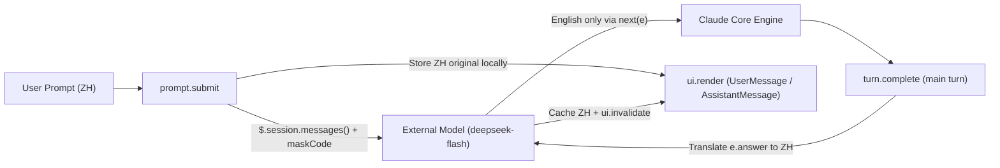

# bilingual-translator

An in-process Claude Code mod that translates Chinese user prompts into English before they reach Claude, and translates Claude's final English responses back into Chinese in the CLI transcript—powered by an external OpenAI-compatible model (`deepseek-flash` with thinking disabled by default) so it **consumes zero Claude quota** and **never leaks Chinese originals into Claude's request context**.

---

## Features

- **Input Translation (`prompt.submit`, ZH → EN)**: Automatically translates prompts containing Chinese into English before sending. Slash commands (`/tr`, `/compact`, etc.) and pure English prompts pass through untouched.
- **Zero Context Leakage**: Original Chinese prompts are stored strictly in local mod memory and `$.store`. Only the translated English text is forwarded via `next({ ...e, text: translated })`; `e.context` is never touched.
- **Bilingual CLI Transcript (`ui.render`)**:
  - `UserMessage`: Displays `[原文] <original Chinese>` alongside `[已发送] <sent English>`.
  - `AssistantMessage`: On `turn.complete` (main agent, non-aborted turns only), translates `e.answer` to Chinese and refreshes the view with English original + `[中文译文]`.
- **Full-Session Disambiguation**: Reads Claude's active session history via `$.session.messages()` and passes `user` / `assistant` turns to the external translator as reference context for pronoun resolution and terminology consistency. Automatically falls back to a history-free retry if the endpoint rejects an oversized payload.
- **Code-Block Masking**: Replaces fenced (` ``` ` / `~~~`) and inline (`` `...` ``) code spans with `[[CODE_n]]` placeholders prior to translation and restores them verbatim afterward.
- **Graceful Degradation**: API timeouts, network failures, or missing credentials fall back to passing the original text through with a non-blocking toast/log notice.

---

## Architecture



---

## Installation & Configuration

### 1. Install from Marketplace

In Claude Code:

```text
/plugin install bilingual-translator --marketplace Everless321/claude-mods
```

Or via CLI:

```bash
claude plugin marketplace add Everless321/claude-mods
claude plugin install bilingual-translator@everless-mods
```

### 2. Configure API Key & Model (Choose One)

- **Option A — Standard Plugin Config (Recommended, stores key in system credential store)**:
  ```bash
  claude plugin configure bilingual-translator@everless-mods
  ```
- **Option B — In-Session Runtime Command**:
  ```text
  /tr set url https://api.deepseek.com/v1
  /tr set key <YOUR_API_KEY>
  /tr set model deepseek-flash
  /tr set thinking off
  /tr set effort low
  ```
- **Option C — Local Override File**:
  Create `~/.claude/bilingual-translator.local.json` (`chmod 600`):
  ```json
  {
    "apiBaseUrl": "https://api.deepseek.com/v1",
    "apiKey": "sk-...",
    "model": "deepseek-flash",
    "disableThinking": true,
    "reasoningEffort": ""
  }
  ```

### `userConfig` Options (`.claude-plugin/plugin.json`)

| Option | Default | Description |
| :--- | :--- | :--- |
| `apiBaseUrl` | `https://api.deepseek.com/v1` | OpenAI-compatible API base URL (DeepSeek, DashScope, OpenRouter, Ollama, etc.) |
| `apiKey` | `""` | External model API key (`sensitive: true`) |
| `model` | `deepseek-flash` | External model ID |
| `disableThinking` | `true` | Sends `"thinking": {"type": "disabled"}` when `true`; enables reasoning when `false` |
| `reasoningEffort` | `""` | Optional `reasoning_effort` (`minimal`, `low`, `medium`, `high`) sent when thinking is enabled |
| `enableInputTranslate` | `true` | Enable ZH → EN prompt translation |
| `enableOutputTranslate` | `true` | Enable EN → ZH final reply translation |
| `timeoutMs` | `15000` | HTTP request timeout in milliseconds |

---

## Slash Commands (`/tr`)

| Command | Action |
| :--- | :--- |
| `/tr` or `/tr status` | Show current input/output toggle state, model, thinking, effort, endpoint, and key status |
| `/tr on` / `/tr off` | Enable or disable both input and output translation |
| `/tr in` / `/tr out` | Toggle input or output translation independently |
| `/tr set <key\|url\|model\|thinking\|effort> <value>` | Update and persist custom API URL, API key, model, thinking (`on\|off`), or effort (`low\|medium\|high\|none`) |

---

## Development & Testing

```bash
claude plugin validate ./bilingual-translator
claude plugin test ./bilingual-translator
```
